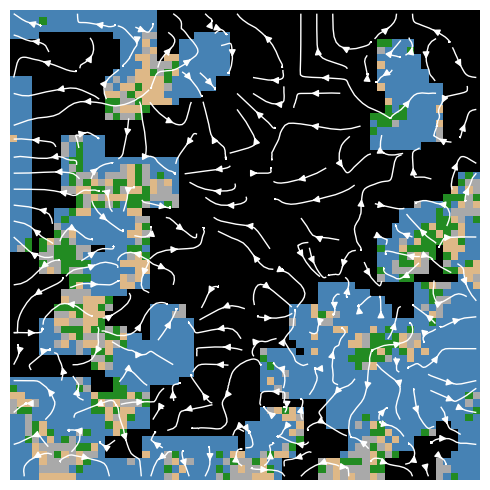

# Emergent Spatial Map Completion in Neural Cellular Automata

This repository contains the code for **"Emergent Spatial Map Completion in Neural Cellular Automata"**.

In the paper, we introduce a Neural Cellular Automata (NeuralCA) approach to multi-agent mapping. Our method enables agents to collaboratively build spatial maps by integrating partial, local observations—using only simple, local interactions rather than global inference. We show that this approach leads to emergent message-passing behavior, allowing for coherent map completion and effective exploration, even in complex environments.

Key highlights from the paper:
- NeuralCA achieves strong map completion accuracy on both synthetic and real-world satellite data.
- Outperforms a U-Net baseline and a non-iterative ablation, while using over 11× fewer parameters.
- Reveals emergent, time-dependent, directional information flow from observed to unobserved regions—demonstrating that spatial coordination can arise from purely local interactions.

Below is Figure 1 from the paper, illustrating the information flow during NeuralCA inference:

  

*Streamlines of averaged gradients during inference, indicating dominant directions of information flow during NeuralCA inference. Local updates demonstrate propagation from observed regions to unobserved regions.*
